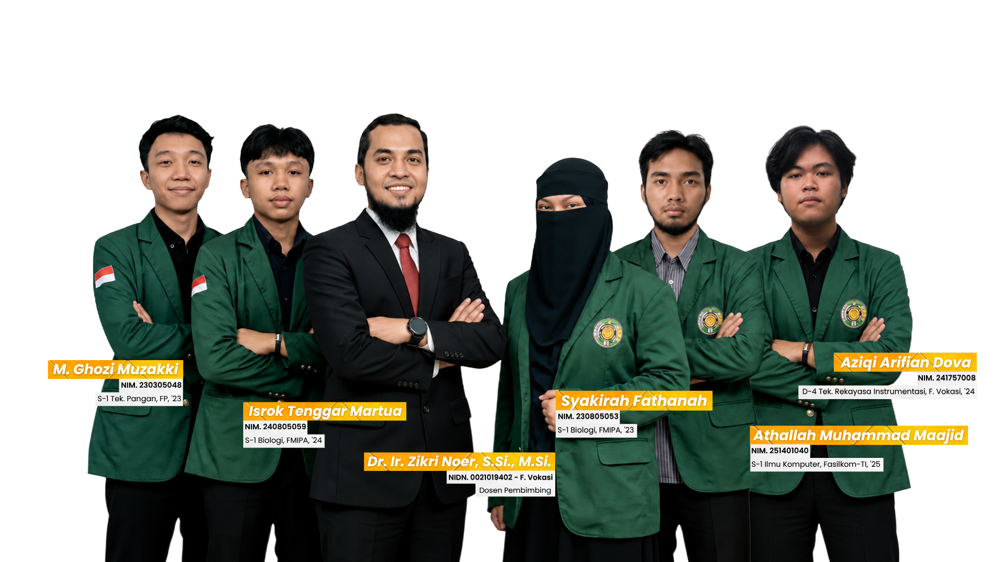
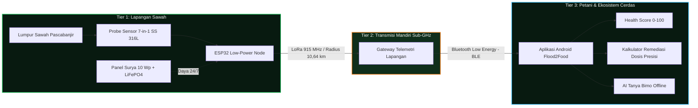

<div align="center">

  

  # 🌾 Flood2Food (PKM-KC USU 2026)
  ### **Sistem Cerdas Pemantauan & Percepatan Pemulihan Lahan Sawah Pascabanjir Berbasis Sensor Fusion 7-in-1, Telemetri LoRa, dan Kecerdasan Buatan AI Tanya Bimo**

  [](https://nextjs.org/)
  [](https://react.dev/)
  [](https://www.typescriptlang.org/)
  [](https://tailwindcss.com/)
  [](https://simbelmawa.kemdikbud.go.id/)
  [](#mitra--dukungan-resmi)
  [](https://github.com/aziqi/Flood2Food/releases/tag/v1.0.0)
  [](LICENSE)

  <p align="center">
    <strong>Pulihkan Lahan Sawah Pascabanjir Berbasis Data Presisi, Bukan Perkiraan.</strong>
    <br />
    Inovasi agroteknologi terdistribusi tanpa ketergantungan sinyal seluler (*zero cellular dependence*) untuk kedaulatan pangan petani Indonesia.
  </p>

  <p align="center">
    <a href="#-tentang-proyek">Tentang Proyek</a> •
    <a href="#-arsitektur-sistem-3-tier">Arsitektur Sistem</a> •
    <a href="#-7-parameter-tanah-kritis">7 Parameter Tanah</a> •
    <a href="#-fitur-utama-website">Fitur Website</a> •
    <a href="#-struktur-direktori">Struktur Direktori</a> •
    <a href="#-panduan-instalasi--menjalankan">Instalasi</a> •
    <a href="#-tim-peneliti--pengembang">Tim Peneliti</a> •
    <a href="#-mitra--dukungan-resmi">Mitra Resmi</a>
  </p>

  

</div>

---

## 📖 Tentang Proyek

Bencana banjir bandang dan genangan luapan sungai pada kawasan persawahan acap kali meninggalkan endapan lumpur pekat anaerobik, penurunan drastis derajat kemasaman (pH ekstrem), pencucian unsur hara makro (N, P, K), serta lonjakan akumulasi garam terlarut (EC). Kondisi ini menyebabkan tanaman padi mengalami keracunan ion aluminium/besi dan memicu gagal panen berkepanjangan bila remediasi tanah hanya dilakukan berdasarkan perkiraan konvensional.

**Flood2Food** hadir sebagai solusi terpadu Program Kreativitas Mahasiswa bidang Karsa Cipta (**PKM-KC**) Universitas Sumatera Utara 2026. Sistem ini mengintegrasikan:
1. **Node Sensor Lapangan 7-in-1**: Elektroda baja tahan karat austenitik (*Stainless Steel 316L*) antikorosi tahan rendaman lumpur pascabanjir.
2. **Telemetri Mandiri LoRa (Long Range 915 MHz)**: Mengirimkan paket data telemetri hingga radius uji **10,64 km** tanpa kuota internet maupun jaringan BTS seluler (*blank spot immunity*).
3. **Gateway Agrikultur BLE**: Penghubung komunikasi langsung ke ponsel pintar (*smartphone*) petani secara lokal melalui Bluetooth Low Energy.
4. **Aplikasi Mobile AI Tanya Bimo**: *On-device intelligence engine* yang menghitung dosis takaran kapur pertanian (dolomit $\text{CaCO}_3$) dan pupuk NPK terkalibrasi formula agronomi BPTP secara instan 100% *offline*.

---

## 🏛️ Arsitektur Sistem 3-Tier



---

## 🔬 7 Parameter Tanah Kritis

Flood2Food memantau matriks kesuburan tanah sawah pascabanjir secara komprehensif melalui *sensor fusion*:

| No | Parameter | Satuan | Rentang Optimal | Risiko Pascabanjir | Tindakan Remediasi Otomatis |
| :---: | :--- | :---: | :---: | :--- | :--- |
| **1** | **pH Tanah** | $\text{pH}$ | $6.0 - 6.8$ | Kemasaman ekstrem mengikat fosfat dan memicu keracunan $\text{Al}^{3+}$ & $\text{Fe}^{2+}$ | Rekomendasi dosis kapur dolomit ($\text{CaCO}_3/\text{MgCO}_3$) per $\text{m}^2$ |
| **2** | **Nitrogen (N)** | $\text{mg/kg}$ | $150 - 250$ | Hanyut terbawa limpasan banjir (*leaching*), daun menguning & kerdil | Perhitungan kebutuhan pupuk Urea bertahap saat bibit berakar |
| **3** | **Fosfor (P)** | $\text{mg/kg}$ | $20 - 40$ | Terfiksasi lumpur asam sehingga tidak dapat diserap akar tanaman | Takaran SP-36 presisi & anjuran inokulasi mikoriza |
| **4** | **Kalium (K)** | $\text{mg/kg}$ | $150 - 300$ | Pencucian hara kalium menyebabkan batang padi rapuh dan mudah rebah | Dosis pemupukan $\text{KCl}$ atau formula NPK berimbang |
| **5** | **Konduktivitas (EC)** | $\mu\text{S/cm}$ | $500 - 1500$ | Deteksi akumulasi salinitas tinggi dari air genangan luapan sungai | Indikator jadwal pencucian (*leaching*) air irigasi bersih |
| **6** | **Kelembaban Tanah** | $\%$ | $60 - 80$ | Kejenuhan air (*waterlogging*) anaerobik membusukkan perakaran bibit | Panduan aerasi parit drainase sawah |
| **7** | **Suhu Tanah** | $^\circ\text{C}$ | $24 - 30$ | Fluktuasi suhu lumpur menghambat aktivitas mikroba dekomposer | Manajemen ketebalan genangan air pelindung mulsa |

---

## ✨ Fitur Utama Website

Repositori ini memuat kode sumber website resmi representasi riset dan diseminasi publik **Flood2Food**:

- 🎨 **Editorial Agro-Dark UI Design**: Skema palet terkurasi *PIMNAS 39 Official Palette* (Forest Dark `#081A10`, Solar Marigold `#F58220`, Sprout Emerald `#22C55E`, Sky Blue `#38BDF8`).
- 🎬 **Video Dokumentasi Riset**: Pratinjau video demonstrasi lapangan sawah dengan pemutar video terintegrasi.
- 📱 **Showcase & Unduh APK Mobile**: Pusat demonstrasi antarmuka aplikasi Android, integrasi BLE, kalkulator dosis, dan tombol unduh langsung file APK.
- 🖼️ **Galeri Dokumentasi Riset Lapangan (22 Foto)**: Grid berdensitas tinggi rasio seragam 4:3 tanpa distraksi teks, dilengkapi *modal lightbox* resolusi penuh dengan navigasi keyboard (`Esc`, `←`, `→`).
- 👥 **Profil Tim Peneliti & Dosen Pembimbing**: Roster terstruktur kolaborasi lintas 4 fakultas Universitas Sumatera Utara.
- ⚡ **Kinerja Tinggi & Aksesibilitas**: Dibangun menggunakan Next.js 16 Turbopack, React 19, animasi kinetik Framer Motion, dan *smooth scrolling* Lenis.

---

## 🛠️ Tumpukan Teknologi (Tech Stack)

### **Frontend & Web Platform**
- **Framework**: [Next.js 16.1.1](https://nextjs.org/) (App Router, Turbopack)
- **Library UI**: [React 19.0.0](https://react.dev/)
- **Bahasa**: [TypeScript 5.x](https://www.typescriptlang.org/)
- **Styling**: [Tailwind CSS v4](https://tailwindcss.com/)
- **Animasi & Interaksi**: [Framer Motion 12.x](https://www.framer.com/motion/)
- **Smooth Scroll**: [Lenis 1.3.x](https://lenis.darkroom.engineering/)
- **Ikonografi**: [Lucide React](https://lucide.dev/)

### **Hardware & Telemetri IoT**
- **Mikrokontroler**: ESP32 Dual-Core Tensilica Xtensa 32-bit (Ultra-Low Power Deep-Sleep)
- **Sensor**: Industrial Soil Probe 7-in-1 Austenitic Stainless Steel 316L (RS485 / Modbus RTU)
- **Transceiver Nirkabel**: Ebyte E220-900T22D LoRa 915 MHz (Daya pancar 22 dBm)
- **Catu Daya Mandiri**: Monocrystalline Solar Panel 10 Wp + MPPT Controller + Baterai LiFePO4 12V 8Ah
- **Protokol Mobile**: Bluetooth Low Energy (BLE 5.0)

---

## 📁 Struktur Direktori

```text
website-flood2food/
├── public/
│   └── assets/
│       ├── gallery/            # 22 foto dokumentasi terkompresi (.webp)
│       ├── logos/              # Logo resmi (USU, Kemendiktisaintek, Belmawa, dll.)
│       ├── mockups/            # Mockup aplikasi Android (Dashboard, Tanya Bimo, Remediasi)
│       ├── team/               # Foto resmi tim peneliti dan dosen pembimbing
│       └── video/              # Video demonstrasi riset lapangan sawah
├── src/
│   ├── app/
│   │   ├── galeri/             # Rute arsip halaman galeri foto
│   │   ├── globals.css         # Desain sistem Tailwind CSS v4 & variabel PIMNAS
│   │   ├── layout.tsx          # Root layout & konfigurasi tipografi Google Fonts
│   │   └── page.tsx            # Halaman utama landing page Flood2Food
│   ├── components/
│   │   ├── layout/             # Komponen global: Navbar, Footer, SmoothScrollProvider
│   │   ├── motion/             # Komponen animasi reusable: Reveal, Magnetic, SplitWords
│   │   └── sections/           # Komponen section:
│   │       ├── hero.tsx        # Hero banner & CTA
│   │       ├── sponsors-bar.tsx# Pita mitra resmi & sponsor
│   │       ├── video-demo.tsx  # Video player demonstrasi lapangan
│   │       ├── iot-system.tsx  # Arsitektur sistem IoT 3-Node
│   │       ├── parameters.tsx  # Cockpit interaktif 7 parameter tanah
│   │       ├── app-showcase.tsx# Fitur aplikasi mobile Android
│   │       ├── app-download.tsx# Section unduh file APK
│   │       ├── team.tsx        # Roster dosen pembimbing & mahasiswa
│   │       ├── gallery.tsx     # Grid 22 foto galeri riset & lightbox
│   │       └── faq.tsx         # Tanya jawab teknis & agronomi
│   ├── data/
│   │   └── gallery.ts          # Katalog metadata 22 foto dokumentasi
│   └── lib/
│       └── utils.ts            # Utility functions (clsx, tailwind-merge)
├── package.json
├── tsconfig.json
└── next.config.ts
```

---

## 🚀 Panduan Instalasi & Menjalankan

### **Prasyarat**
- [Node.js](https://nodejs.org/) versi `>= 20.x` atau [Bun](https://bun.sh/) versi `>= 1.1.x`
- Git

### **Langkah-Langkah**

1. **Clone repositori**:
   ```bash
   git clone https://github.com/aziqi/website-f2f_next.js.git
   cd website-f2f_next.js
   ```

2. **Pasang dependensi**:
   Menggunakan **Bun** (direkomendasikan):
   ```bash
   bun install
   ```
   *Atau menggunakan npm / pnpm / yarn:*
   ```bash
   npm install
   ```

3. **Jalankan server pengembangan (*development server*)**:
   ```bash
   bun run dev
   # atau
   npm run dev
   ```

4. **Buka di peramban**:
   Akses `http://localhost:3000` pada browser Anda.

5. **Membangun versi produksi (*production build*)**:
   ```bash
   bun run build
   bun run start
   ```

---

## 👥 Tim Peneliti & Pengembang

Inovasi **Flood2Food** lahir dari kolaborasi lintas disiplin ilmu mahasiswa dan dosen pembimbing **Universitas Sumatera Utara**:

### **Dosen Pembimbing**
<div align="center">
  <table>
    <tr>
      <td align="center">
        <strong>Dr. Ir. Zikri Noor, S.Si., M.Si.</strong><br />
        <sub>NIDN: 0021078403 · Fakultas Vokasi, Universitas Sumatera Utara</sub><br />
        <em>Bidang Kepakaran: Instrumentasi Fisika, Sensorika &amp; Metrologi Agrikultur</em>
      </td>
    </tr>
  </table>
</div>

### **Mahasiswa Peneliti (PKM-KC USU 2026)**
| Nama Mahasiswa | NIM | Program Studi / Fakultas | Peran dalam Tim | Fokus Riset |
| :--- | :---: | :--- | :--- | :--- |
| **Syakirah Fathanah** | 230805053 | S-1 Biologi, FMIPA '23 | **Ketua Tim** | Formulasi Biologi Pemulihan & Manajemen Riset |
| **Athallah M. Maajid** | 251401040 | S-1 Ilmu Komputer, Fasilkom-TI '25 | **Software Lead** | Arsitektur Mobile Android, BLE & Algoritma Rekomendasi |
| **Aziqi Arifian Dova** | 241757008 | D-4 Rek. Instrumentasi, F. Vokasi '24 | **Hardware Lead** | Node Sensor 7-in-1, Transmisi LoRa & Power Circuit |
| **M. Ghozi Muzakki** | 230305048 | S-1 Tek. Pangan, FP '23 | **Agronomi & Mutu** | Validasi Lapangan Sawah & Evaluasi Pascapanen |
| **Isrok Tenggar Martua** | 240805093 | S-1 Biologi, FMIPA '24 | **Bio-Remediasi** | Kultur Mikroorganisme & Efektivitas Hayati |

---

## 🏛️ Mitra & Dukungan Resmi

Program ini didukung dan didanai secara resmi oleh:
- **Kementerian Pendidikan Tinggi, Sains, dan Teknologi (Kemendiktisaintek RI)**
- **Direktorat Jenderal Pembelajaran dan Kemahasiswaan (Belmawa)**
- **SIMBELMAWA (Sistem Informasi Pembelajaran dan Kemahasiswaan)**
- **Universitas Sumatera Utara (USU)**
- **PKM Center Universitas Sumatera Utara**
- **Pekan Ilmiah Mahasiswa Nasional (PIMNAS 39)**
- **Laboratorium Penguji BPTP Sumatera Utara (Terakreditasi KAN LP-863-IDN)**

---

## 📄 Lisensi

Hak Cipta © 2026 **Tim Peneliti Flood2Food Universitas Sumatera Utara**.  
Proyek ini dilisensikan di bawah naungan [MIT License](LICENSE).

<div align="center">
  <sub>Dibuat dengan dedikasi untuk petani Indonesia · <strong>#TanahSehatSawahKuat</strong></sub>
</div>
